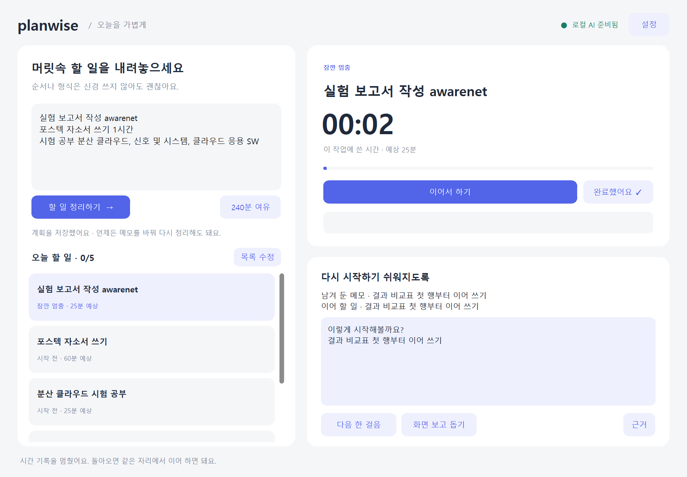

# Planwise Local

**역할별 공개 데이터 학습:** [CameraGaze · ScreenLayout · GoalHistory](docs/PUBLIC_SPECIALISTS_KO.md). 개인 기록만으로 모델 전체를 학습하는 대신 MPIIGaze·GroundCUA·Mind2Web로 기본 능력을 학습합니다. 실제 공개 데이터 예비 가중치와 성적을 생성했고, [HPC 실행 스크립트](scripts/train-public-specialists.sh)로 데이터 확보부터 학습까지 재현할 수 있습니다. 예비 모델의 낮은 성능을 제품 수준으로 주장하지 않습니다.

현재 실행·학습 안내: [Planwise Return 구현 상태](docs/RETURN_IMPLEMENTATION_KO.md). Granite 메모 파싱, Qwen 복귀 제안, 선택적 시각 관측, CNN/GRU 학습·불러오기·개인 보정을 앱에 연결했습니다. 실제 사용자 데이터로 학습한 시각/맥락 모델은 아직 없으며 미학습 상태에서 판단하지 않습니다. [전체 설계](docs/RETURN_AGENT_DESIGN_KO.md)에는 후속 범위도 포함돼 있습니다.

**계획을 실행으로 연결하는 로컬 생산성 에이전트.** ActivityWatch·외부 API 없이 실행되는 Windows 데스크톱 MVP입니다. 자유 메모 파싱은 로컬 Granite 4 3B, 복귀 제안과 선택적 화면 문구 읽기는 Qwen3.5-4B를 사용합니다. CNN/GRU 및 카메라는 별도 연구 의존성이 필요합니다.

기본 화면은 **CustomTkinter 기반의 한 화면 작업 공간**입니다. 왼쪽에서 메모를 정리하고, 오른쪽에서 타이머·쉬기·복귀·완료를 이어갑니다. 연구용 설정은 기본 화면에서 분리했습니다. [새 데스크톱 사용·검증 안내](docs/DESKTOP_GUIDE_KO.md)

상태: **복귀 지원 앱 + 별도 카메라/화면 CNN·시간 맥락 GRU 학습 경로**. 관측은 선택적 단발 캡처이고 모델 파일은 직접 학습해 불러옵니다. 실제 사용자 정확도나 생산성 향상이 검증된 제품은 아닙니다.



## 바로 실행

Python 3.11 이상(Tkinter 포함)을 설치한 뒤:

```bash
git clone --branch codex/local-plan-agent https://github.com/sijoon-sung/AI-focus-mangement-agent.git
cd AI-focus-mangement-agent
python -m pip install -r requirements-desktop.txt
python -m local_agent
```

Windows에서는 의존성 설치 후 `Start-Planwise.cmd`를 더블클릭해도 됩니다. 일상 UI에는 CustomTkinter와 Pillow만 필요하며 PyTorch는 선택적인 연구 기능용입니다. 이전 화면은 `python -m local_agent --classic`으로 열 수 있습니다.

예제 작업으로 먼저 보려면 실제 데이터와 분리해서 실행하세요.

```bash
python -m local_agent --demo --data-dir local_data/demo
```

## 구현 기능

- 완료 조건·다음 행동·예상 시간·우선순위·선행 작업이 있는 계획 관리.
- 작업 세션 시작, 중단 메모, 복귀, 사용자 완료 확인.
- 대기 확인 타이머와 가용 시간 기반 다음 작업 추천.
- 실제 점수 기여·제외 사유·추정 한계를 보여주는 근거 카드.
- 개인 완료 작업의 세션 시간 보정과 명시적으로 확인한 앱 범주 연결 후보.
- 선택적 Windows 앱 범주/유휴 관측, 기간 제한·범주 제외·삭제·집계 내보내기.

**기본 수집은 꺼짐입니다.** 창 제목·URL·키 입력 내용·스크린샷·카메라·클립보드는 수집하지 않습니다. 데이터는 로컬 SQLite에 저장되며 DB 암호화는 없습니다. 동기화 폴더 밖에 저장하려면 `--data-dir`로 지정하세요.

대기 타이머는 다시 확인할 시각을 알려줄 뿐 실행 완료를 감지하지 않습니다. 창을 닫으면 세션과 수집이 끝납니다. 트레이 상주·백그라운드 서비스·OS 토스트는 후속 기능입니다.

## 문서

- [프로젝트 계획서](docs/PROJECT_PLAN_KO.md)
- [사용 안내](docs/LOCAL_AGENT_GUIDE_KO.md)
- [검증 기록](docs/LOCAL_AGENT_VALIDATION.md)
- [이전 CNN 연구 트랙](docs/RUNBOOK_KO.md): 선택적 시각 모듈 실험 기반

## 테스트

```bash
python -m unittest discover -s tests -p test_local_agent.py -v
python -m local_agent --demo --ui-smoke --data-dir runs/ui-smoke
```

`local_agent/store.py`는 저장, `planner.py`는 설명 가능한 규칙, `desktop.py`는 기본 UI, `app.py`는 이전 연구 중심 UI를 담당합니다.

기존 `main.py`와 `core/`는 이전 MediaPipe·ActivityWatch·Gemini 프로토타입입니다. 새 앱은 `python -m local_agent`로 실행하며 이전 서비스를 호출하지 않습니다.

## 자체 학습 기능 추가

사용자가 확인한 활동 통계로 작은 작업 종류 모델을 처음부터 학습할 수 있습니다. 학습·평가 명령과 개인정보 처리, 실제 데이터의 한계는 [자체 학습 안내](docs/MODEL_TRAINING_KO.md)를 참고하세요. 합성 데이터 학습은 검증용이며 실제 사용자 성능을 뜻하지 않습니다.
