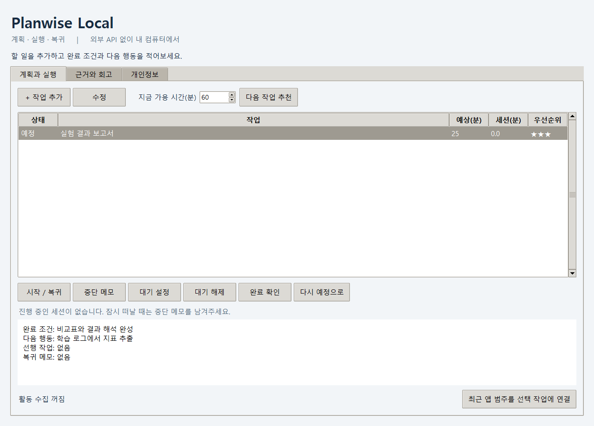

# Planwise Local

후속 설계: [Planwise Return — 작업 복귀를 돕는 로컬 AI](docs/RETURN_AGENT_DESIGN_KO.md). Qwen3.5-4B/Ollama, 카메라·화면 모델, 시간 맥락 추론, 개인 보정, 수정 가능한 근거와 학습·평가 계획을 명세했습니다. 신규 파이프라인은 아직 앱에 통합되지 않았습니다.

**계획을 실행으로 연결하는 로컬 생산성 에이전트.** ActivityWatch·외부 API 없이 실행되는 Windows 데스크톱 MVP입니다. 앱은 Python 표준 라이브러리와 Tkinter를 사용하며, 자유 메모 정리에는 선택적으로 로컬 Ollama의 Qwen3.5-4B를 사용합니다.

새 시작 화면: **메모 적기 → 할 일 정리해줘 → 좋아, 시작하자**. 예상 시간과 배치는 완료 기록을 참고하고, 자세한 설정은 필요할 때만 열 수 있습니다. [메모와 하루 계획 안내](docs/INBOX_GUIDE_KO.md)

상태: **규칙 기반 MVP + 직접 학습 가능한 활동 종류 모델**. 실제 사용자 데이터로 학습한 집중력 모델이나 생산성 향상 효과가 검증된 제품은 아닙니다. 화면·카메라 관측, 소형 신경망, EBM, IDE 실행 완료 연동은 후속 연구 범위입니다.



## 바로 실행

Python 3.11 이상(Tkinter 포함)을 설치한 뒤:

```bash
git clone --branch codex/local-plan-agent https://github.com/sijoon-sung/AI-focus-mangement-agent.git
cd AI-focus-mangement-agent
python -m local_agent
```

Windows에서는 `Start-Planwise.cmd`를 더블클릭해도 됩니다. `pip install`은 필요 없습니다. 연구용 PyTorch 의존성을 설치할 필요도 없습니다.

예제 작업으로 먼저 보려면 실제 데이터와 분리해서 실행하세요.

```bash
python -m local_agent --demo --data-dir local_data/demo
```

## 구현 기능

- 완료 조건·다음 행동·예상 시간·우선순위·선행 작업이 있는 계획 관리.
- 작업 세션 시작, 중단 메모, 복귀, 사용자 완료 확인.
- 대기 확인 타이머와 가용 시간 기반 다음 작업 추천.
- 실제 점수 기여·제외 사유·추정 한계를 보여주는 근거 카드.
- 개인 완료 작업의 세션 시간 보정과 명시적으로 확인한 앱 범주 연결 후보.
- 선택적 Windows 앱 범주/유휴 관측, 기간 제한·범주 제외·삭제·집계 내보내기.

**기본 수집은 꺼짐입니다.** 창 제목·URL·키 입력 내용·스크린샷·카메라·클립보드는 수집하지 않습니다. 데이터는 로컬 SQLite에 저장되며 DB 암호화는 없습니다. 동기화 폴더 밖에 저장하려면 `--data-dir`로 지정하세요.

대기 타이머는 다시 확인할 시각을 알려줄 뿐 실행 완료를 감지하지 않습니다. 창을 닫으면 세션과 수집이 끝납니다. 트레이 상주·백그라운드 서비스·OS 토스트는 후속 기능입니다.

## 문서

- [프로젝트 계획서](docs/PROJECT_PLAN_KO.md)
- [사용 안내](docs/LOCAL_AGENT_GUIDE_KO.md)
- [검증 기록](docs/LOCAL_AGENT_VALIDATION.md)
- [이전 CNN 연구 트랙](docs/RUNBOOK_KO.md): 선택적 시각 모듈 실험 기반

## 테스트

```bash
python -m unittest discover -s tests -p test_local_agent.py -v
python -m local_agent --demo --ui-smoke --data-dir runs/ui-smoke
```

`local_agent/store.py`는 저장, `planner.py`는 설명 가능한 규칙, `sensors.py`는 Windows 수집, `app.py`는 UI를 담당합니다.

기존 `main.py`와 `core/`는 이전 MediaPipe·ActivityWatch·Gemini 프로토타입입니다. 새 앱은 `python -m local_agent`로 실행하며 이전 서비스를 호출하지 않습니다.

## 자체 학습 기능 추가

사용자가 확인한 활동 통계로 작은 작업 종류 모델을 처음부터 학습할 수 있습니다. 학습·평가 명령과 개인정보 처리, 실제 데이터의 한계는 [자체 학습 안내](docs/MODEL_TRAINING_KO.md)를 참고하세요. 합성 데이터 학습은 검증용이며 실제 사용자 성능을 뜻하지 않습니다.
