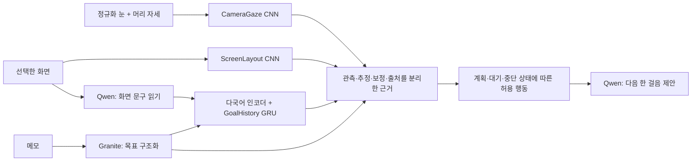

# 개인 기록 없이 기본 능력을 학습하는 역할별 모델

## 변경한 전제

사용자 한 사람의 기록으로 시각 모델과 시간 모델 전체를 학습시키는 구조를 폐기한다. **공개 데이터로 기본 능력 학습 → 공개 데이터의 미관측 집단에서 평가 → 적은 개인 보정 → 복귀 제안** 순서다. 기존 `train_return.py`의 임의 상태 라벨 모델과 별도로, 실제 공개 정답에 맞춘 입력·출력·손실을 가진 모델을 구현했다.

현재 코드는 세 역할의 공개 데이터 다운로드, 변환, 학습, 평가, 오프라인 추론까지 실행한다. 다만 예비 학습의 낮은 성능을 완성품으로 포장하지 않는다. 실행 가능한 코드와 가중치가 있다는 것, 목표 성능을 달성했다는 것은 다르다.

## 모델별 책임

| 모듈 | 실제 입력과 출력 | 모델·학습 목표 | 데이터 |
|---|---|---|---|
| CameraGaze | 정규화한 눈 이미지 60×36 + 머리 각도 + 좌/우 → 3D 시선 벡터 | 별도 EyeGazeCNN, 단위 벡터 cosine loss | MPIIGaze의 실제 시선·머리 자세 정답 |
| ScreenLayout | 화면 → 버튼·메뉴·입력 요소 등 8종의 32×32 점유 맵 | ImageNet MobileNetV3-Small + stride-8 세부 특징 결합 + 학습한 dense head, masked BCE | GroundCUA 실제 UI 박스·요소 종류 |
| GoalHistory | 행동 직전 화면 텍스트의 이력 + 후보 목표 → 관련성 점수와 다음 CLICK/TYPE/SELECT | 다국어 MiniLM은 고정, GRU·관련성 투영·동작 head는 자체 학습; contrastive loss + CE | Mind2Web 공개 TRAIN의 목표·행동 이전 DOM 텍스트·실제 동작 |
| 메모 이해 | 자유 메모 → 목표 목록 | 기존 Granite 4 3B | 사전학습 모델 사용, 자체 학습했다고 주장하지 않음 |
| 복귀 제안 | 계획·중단 메모·관측·각 모델의 추정 → 허용된 다음 행동 제안 | 기존 로컬 Qwen 3.5 4B | 기록에서 근거를 인용, 작업 완료 권한 없음 |

카메라 모델은 '집중/딴짓'을 예측하지 않는다. 화면 모델은 화면 종류만 보고 작업 의도를 결정하지 않는다. GRU는 공개 데이터에 없는 생산성·의도·완료 정답을 만들어 학습하지 않는다. 서로 다른 모듈의 결과를 같은 의미의 확률로 취급하지 않는다.



다이어그램의 카메라→근거 연결은 **정규화·캘리브레이션을 갖춘 입력**이 전제다. 현 앱의 얼굴 crop을 이 눈 모델에 넣는 편법은 금지하며 입력 크기 검사로 막는다. 현재 기본 UI에 연결한 새 모델은 화면·목표 이력이다. 카메라 모델은 정규화된 입력으로 오프라인 추론하며, 실시간 랜드마크 검출·기하 정규화와 통합한 웹캠 입력 경로는 아직 추가 작업이 필요하다.

## 공개 데이터와 사용 조건

- **MPIIGaze**: 연구자 공식 데이터는 15명의 노트북 사용 중 수집한 눈 이미지·시선·자세를 제공한다. 공식 정규화 데이터를 그대로 사용한다. CC BY-NC-SA 4.0 및 비상업 과학 연구 조건을 확인하고 대학원 연구용으로 사용한다. [공식 데이터 설명·원문](https://www.mpi-inf.mpg.de/departments/computer-vision-and-machine-learning/research/gaze-based-human-computer-interaction/appearance-based-gaze-estimation-in-the-wild)
- **GroundCUA**: 87개 소프트웨어의 화면과 요소 위치·종류 주석을 제공하며 MIT로 공개되어 있다. 현재 변환기는 12개 앱을 고정해 앱 단위로 분리한다. 종류가 없는 요소는 '기타'로 정답을 날조하지 않고 해당 영역을 학습 손실에서 제외한다. [공식 데이터 카드](https://huggingface.co/datasets/ServiceNow/GroundCUA)
- **Mind2Web**: 목표·웹사이트·행동 순서·행동 이전 HTML을 포함한다. TRAIN 샤드만 받아 웹사이트 단위로 자체 train/val/test를 구성한다. 원본 테스트 세트를 학습하거나 다시 배포하지 않는다. 데이터 CC BY 4.0. [공식 저장소](https://github.com/OSU-NLP-Group/Mind2Web), [학습 데이터](https://huggingface.co/datasets/osunlp/Mind2Web)

ScreenSpot은 GUI 평가 벤치마크여서 이번 학습 데이터로 쓰지 않는다. SWELL의 스트레스/작업 조건 라벨을 개인의 딴짓 정답으로 변환하지 않는다. 자료가 비슷해 보인다는 이유만으로 서로 다른 정답을 섞지 않는다.

원본 공개 데이터·이미지·가중치는 GitHub 코드 커밋에 넣지 않는다. 다운로드한 데이터는 `data/public/`, 모델과 인코더 캐시는 `runs/`에 둔다. `source.json`에 공급자, revision, 라이선스, 파일 checksum과 분할을 기록한다. 미러에서 임의로 재라벨한 데이터는 사용하지 않는다.

## 누수 방지와 평가

- CameraGaze: p00–p10 학습, p11–p12 검증, p13–p14 평가. **이 자체 분할의 결과를 공식 leave-one-person-out 성능처럼 발표하면 안 된다.** 각 사람의 여러 날짜에 걸쳐 reservoir sampling한다. 좌우 눈도 같은 사람 분할에 남는다.
- ScreenLayout: 학습 앱 VSCode/LibreOffice Writer/Bash/VLC/GIMP/Firefox, 검증 앱 PyCharm/OnlyOffice Document Editor/Ubuntu Terminal, 평가 앱 Geany/Joplin/Chromium. 같은 이미지 hash가 다른 분할에 들어오면 중단한다. 평가는 요소 점유 IoU이며 클릭 위치 정확도가 아니다.
- GoalHistory: 웹사이트 전체를 한 분할에 넣고 한 작업의 모든 prefix가 함께 이동한다. 목표는 입력이지만 미래 동작 이름·정답 후보 ID는 입력에 넣지 않는다. j번째 행동 직전 화면으로 j번째 다음 동작을 예측한다. 화면 전사는 DOM 텍스트와 차이가 있으므로 실제 OCR 입력은 추가적인 도메인 전이 평가가 필요하다.
- 모형 선택은 validation loss, GRU/고정 임베딩 결합 비율은 validation MRR만 사용한다. test 결과를 보고 결합 비율을 고르지 않는다. 이미 예비 실험에 사용한 내부 test는 탐색 평가로 표시하며 최종 논문 성능은 별도 고정 평가로 확인해야 한다.
- GRU 자체 결과와 고정 다국어 임베딩 기준선을 같이 보고한다. 다음 동작은 클래스 빈도를 보정해 학습하고 accuracy·macro-F1·혼동행렬·최빈 동작 기준선을 함께 보고한다. CLICK만 예측해 높은 정확도를 얻는 것을 성공으로 해석하지 않는다. 일부 이력을 놓친 상황은 2개/4개 간격 관측으로 평가한다. 누락된 시간 구간을 새 관측으로 채우지 않는다.

## 실제로 수행한 예비 학습

`runs/public-models/*.pt`는 합성 잡음이 아니라 실제 공개 데이터로 학습한 파일이다. 각 파일의 `.metrics.json`이 해당 실행의 정확한 수치와 출처다. `pilot=true`는 완성 모델 인증이 아니라 공개 데이터 경로를 실제 학습으로 검증한 예비 모델임을 뜻한다.

- 카메라: 15명에서 300개씩, 총 4,500개 눈 이미지. train 3,300 / val 600 / test 600, 5 epochs. 테스트 평균 각도 오차 약 **7.31°**. 개인 웹캠·화면 좌표·집중도 정확도가 아니다.
- 화면: 576개 화면 중 종류 정답이 있는 544개를 사용했다(train 277 / val 141 / test 126). 10 epochs 학습 후 테스트 점유 맵 macro-IoU는 **0.155**다. 초기 작은 데이터와 단순 coarse decoder보다 개선했지만, 이 수치를 실용적인 GUI 인식 완성도로 해석할 수 없다. 드문 Sidebar 클래스는 아직 학습이 불충분하다.
- 목표 이력: TRAIN 샤드 0·10의 109개 작업으로 550 / 129 / 144개 prefix를 만들었다. 행동 이름을 입력으로 쓰던 초기 실험은 실제 화면 입력과 달라 최종 모델에서 교체했다. 최종 입력은 행동 이전 페이지 텍스트다. 관련성 모델의 성능은 아직 충분하지 않으며 다음 동작 정확도도 최빈 기준선과 함께 해석해야 한다.

목표 이력 모델은 12 epochs 학습했다. 평가 사이트의 후보 목표 18개에서 고정 임베딩 기준선의 top-1은 11.8%, GRU 단독은 9.7%, 검증 세트에서 선택한 결합(GRU 0.25)은 20.1%였다. 결합 MRR은 0.333이다. 이력을 2개/4개 간격으로 관측하면 결합 top-1은 각각 19.4%였다. 이는 작은 웹 작업 데이터의 탐색 결과이며 실제 사용자의 의도를 20.1% 정확도로 알아낸다는 의미가 아니다.

다음 동작 macro-F1은 0.381로 최빈 CLICK 기준선 0.318보다 높지만, accuracy는 67.4%로 해당 기준선 91.0%보다 낮다. 클래스 불균형을 보정했으며 희소 TYPE/SELECT 예측은 여전히 약하다. 일부 수치만 골라 모델이 우수하다고 주장하지 않는다. 원본 평가 보고서는 [예비 실험 기록](experiments/public-specialists-pilot/)에 보존한다.

검증: UI를 포함한 60개 자동 테스트 통과. 세 최종 체크포인트를 다시 로드해 미관측 공개 데이터에서 오프라인 추론과 관측 제거 설명을 실행했다. 로컬 Granite·Qwen과 화면/이력 모델의 앱 연결도 별도 합성 창으로 실행했다. 이 통합 검증은 실제 개인 화면을 수집하지 않았으며 모델 정확도나 생산성 개선을 증명하는 실험은 아니다.

이 규모는 전체 데이터 학습을 대체하지 않는다. 카메라·화면·문맥 전체가 제품 수준으로 검증됐다고 주장하지 않는다. 이전의 '실제 개인 데이터가 없어서 학습할 수 없음' 상태와 달리, 사용자 데이터를 요구하지 않는 재현 가능한 학습 경로와 실제 가중치·결과를 확보한 상태다.

## HPC / 랩 컴퓨터에서 본 학습

CUDA 버전에 맞는 torch/torchvision을 먼저 설치한다. 연구 의존성은 별도 가상환경에서 설치한다.

```bash
python -m pip install -r requirements-specialists.txt
bash scripts/train-public-specialists.sh cuda
```

다운로드 규모: MPIIGaze 약 2.1GB 압축 파일, Mind2Web 전체 TRAIN 약 5.9GB, GroundCUA는 앱별 선택 수에 따라 달라진다. 추출 데이터와 모델 캐시 공간도 필요하다. 스크립트는 카메라 사람별 3,000개, 화면 앱별 최대 1,000장, Mind2Web 모든 TRAIN 샤드를 사용한다. 이는 명시적으로 제한한 재현 가능한 첫 본 학습 설정이며 전체 GroundCUA 87개 앱 전량 학습은 아니다.

Windows에서도 개별 명령을 실행할 수 있다.

```powershell
python -m research.public_data mpiigaze
python -m research.public_data groundcua --per-app 1000
python -m research.public_data mind2web --shards 0 1 2 3 4 5 6 7 8 9 10
python -m research.train_specialists --role camera_gaze --per-person 3000 --epochs 40 --device cuda --output runs/full-public/camera_gaze.pt
python -m research.train_specialists --role screen_layout --epochs 30 --device cuda --output runs/full-public/screen_layout.pt
python -m research.train_specialists --role goal_history --epochs 30 --device cuda --output runs/full-public/goal_history.pt
```

`--device cpu`도 지원한다. 현재 환경의 검증은 CPU에서 했으며 CUDA/HPC 실행 자체를 검증했다고 주장하지 않는다. 코드 변경 시 기존 encoded cache는 manifest checksum에 따라 분리한다. 원본 변경·다른 데이터 버전은 별도 폴더에 받아 출처를 혼동하지 않는다.

## 추론과 앱 연결

```powershell
python -m research.infer_specialist --checkpoint runs/public-models/screen_layout.pt --image path/to/approved-screen.png --output runs/layout.json
python -m research.infer_specialist --checkpoint runs/public-models/goal_history.pt --observations "실험 진행 중" "결과 표 확인" --goals "실험 보고서 작성" "자소서 작성" --output runs/alignment.json
python -m research.infer_specialist --checkpoint runs/public-models/camera_gaze.pt --image path/to/normalized-eye.png --head-angles 0.1 -0.2 --side left --output runs/gaze.json
```

화면/문맥 모델은 앱 **설정 → 공개 데이터 학습 모델 연결**에서 두 `.pt`가 있는 폴더를 선택한다. 이후 **화면 보고 돕기**에서 사용자가 선택한 화면을 읽을 때만 실행한다. 본 학습 파일도 평가를 확인한 뒤 연결해야 한다. 예비 모델은 예비 모델이라고 근거에 표시하고 자동 작업 완료·집중 판정에 사용하지 않는다. 모델 한 개가 실패해도 화면 읽기 자체와 기존 복귀 카드가 함께 실패하지 않게 분리했다.

다국어 인코더는 추론 시 다운로드하지 않는다. 학습 시 생성된 인코더 캐시 `runs/hf-cache/`를 같은 환경에서 사용하거나 별도로 준비한다. Qwen·Granite와 달리 Ollama 모델이 아니라 고정 문장 인코더다.

## XAI와 개인 보정

추정 결과마다 가중치 hash와 role, 예비 여부, 관측 기록 ID를 남긴다. 목표 관련성은 사용한 관측을 하나씩 제외한 뒤 점수를 다시 계산한 변화량을 제공한다. 이는 실제 모델 점수의 민감도이며 사용자의 심리나 행동 원인에 대한 인과 설명은 아니다. UI 점유 맵은 모델 출력이지 그 자체가 완전한 XAI 증명은 아니다.

개인 데이터가 필요한 부분은 기본 학습과 분리한다.

- 시선: 장치·자세에 맞는 소수의 보정점. `ScreenCalibration`은 고정된 기하 조건의 간단한 보정 API이며 실시간 웹캠 캘리브레이션 UI 완성을 뜻하지 않는다.
- 계획: 사용자가 선택한 목표와 수정 피드백. 화면 문구와 목표 관련성이 애매하면 보류한다.
- 시간: 완료 세션 기록으로 기존 시간 예측을 보정한다.
- 개입: 도움이 됐는지 피드백으로 제안 시점·강도를 조절하는 후속 개인화. 공개 모델 학습용으로 사용자의 화면 수천 장을 요구하지 않는다.
